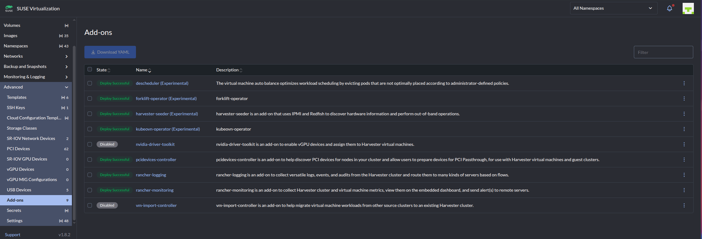
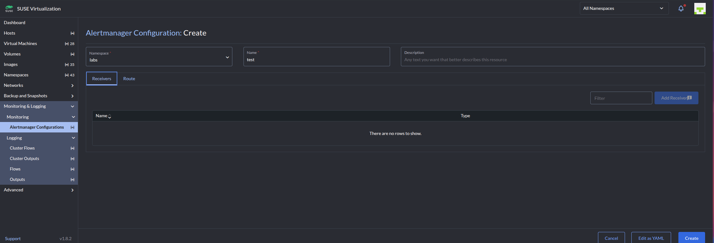
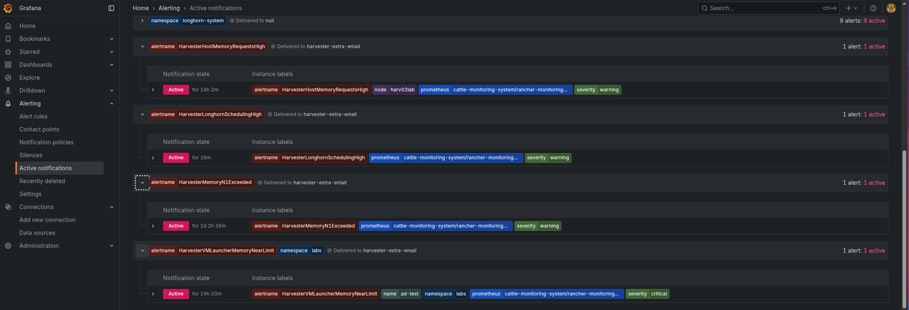

# Harvester: email alerts from the built-in Alertmanager

**English** | [Português (pt-BR)](README.pt-BR.md)

> [!NOTE]
> The predefined alerts are **already enabled and firing** on a default Harvester install. Only the destination is
> missing: out of the box Alertmanager sends everything to a `null` receiver, which drops it. You only need to point it somewhere.

> [!TIP]
> Fastest path: paste the block from the [Quick start](#1-quick-start) into **Advanced -> Addons -> rancher-monitoring -> Edit YAML**,
> or run [`harvester-alert-email.sh`](harvester-alert-email.sh) (try `--dry-run` first).

> [!WARNING]
> **Expect a burst of mail on first apply.** Every matching alert that is firing at that moment is emailed once, plus a
> "resolved" mail when it clears. Check what is firing first ([section 9](#9-seeing-alerts-and-verifying-delivery)).

> [!WARNING]
> The SMTP password is stored **in plain text** in the add-on values (Option A) or in a Secret (Option B).

> [!CAUTION]
> A namespaced `AlertmanagerConfig` (Option B) silently **misses PVC and Longhorn alerts**; they are dropped to `null`.
> Prefer Option A for capacity alerts ([section 7](#7-option-b-a-namespaced-alertmanagerconfig)).

How to make a **default** Harvester 1.8.x install send its predefined alerts (storage, disk, CPU/memory
capacity, node health, ...) to an email address, or to a webhook/Slack, using only what ships with the
`rancher-monitoring` add-on.

The comments in the files under `examples/` are bilingual (English and pt-BR). The script prompts are in English.

## What is in this directory

```
harvester-alert-email/
├── README.md                     this guide
├── README.pt-BR.md               Portuguese (pt-BR) version of this guide
├── harvester-alert-email.sh      interactive script that applies the configuration
├── docs/images/                  screenshots used in the guides
└── examples/
    ├── addon-values/             Alertmanager config to paste into the add-on (Option A)
    │   ├── 01-email-everything.yaml
    │   ├── 02-email-capacity-only.yaml
    │   ├── 03-email-critical-only.yaml
    │   ├── 04-multiple-recipients.yaml
    │   ├── 05-open-relay-no-auth.yaml
    │   ├── 06-split-by-severity.yaml
    │   ├── 07-webhook-instead-of-email.yaml
    │   └── 08-slack.yaml
    ├── alertmanagerconfig/       namespaced objects (Option B)
    │   ├── 01-smtp-secret.yaml
    │   ├── 02-node-alerts-email.yaml
    │   └── 03-matcher-strategy-none.yaml
    └── prometheus-rules/
        ├── longhorn-capacity.yaml   custom Longhorn disk-usage alerts
        └── test-alert.yaml          temporary always-firing alert for end-to-end tests
```

## Contents

1. [Quick start](#1-quick-start)
2. [How the pieces fit](#2-how-the-pieces-fit)
3. [Default state and built-in alerts](#3-default-state-and-built-in-alerts)
4. [Before you start](#4-before-you-start)
5. [Recipes (Option A, add-on values)](#5-recipes-option-a-add-on-values)
6. [Using the script](#6-using-the-script)
7. [Option B: a namespaced AlertmanagerConfig](#7-option-b-a-namespaced-alertmanagerconfig)
8. [Longhorn capacity alerts](#8-longhorn-capacity-alerts)
9. [Seeing alerts and verifying delivery](#9-seeing-alerts-and-verifying-delivery)
10. [Troubleshooting](#10-troubleshooting)
11. [Rollback](#11-rollback)
12. [What was tested](#12-what-was-tested)

---

## 1. Quick start

The predefined alerts are **already enabled and firing**. Only the destination is missing: by default
Alertmanager sends everything to a `null` receiver, which drops it.

To email every predefined alert (except `Watchdog`, an always-firing heartbeat):

1. In the Harvester UI open **Advanced -> Addons -> `rancher-monitoring` -> Edit YAML**.
2. Find the existing `alertmanager:` block. Replace **only its `config:` section** (by default just
   `global: resolve_timeout: 5m`) with the block below. Leave every other key
   (`enabled`, `service`, `alertmanagerSpec`, ...) untouched, and do not add a second `alertmanager:` key.
3. Edit the SMTP host, sender, credentials and recipient, then save.
4. Wait 1-2 minutes while the add-on redeploys (Advanced -> Addons returns to *Deploy Successful*).

```yaml
# Email EVERY predefined alert (except Watchdog/InfoInhibitor) to one address.
# Paste into: Advanced -> Addons -> rancher-monitoring -> Edit YAML.
# Replace only the `config:` section inside the existing `alertmanager:` block.
# [pt-BR] Envia por email TODOS os alertas predefinidos (exceto Watchdog/InfoInhibitor) para um endereço.
# Cole em: Advanced -> Addons -> rancher-monitoring -> Edit YAML.
# Substitua somente a seção `config:` dentro do bloco `alertmanager:` existente.
alertmanager:
  config:
    global:
      resolve_timeout: 5m
      smtp_smarthost: "smtp.customer.com:587"
      smtp_from: "harvester-alerts@customer.com"
      smtp_auth_username: "harvester-alerts@customer.com"
      smtp_auth_password: 'PASSWORD'
      smtp_require_tls: true
    route:
      receiver: "null"
      group_by: [alertname, namespace]
      routes:
        - receiver: "null"
          matchers: ['alertname=~"Watchdog|InfoInhibitor"']
        - receiver: email-ops
          repeat_interval: 4h
          matchers: ['alertname=~".+"']
    receivers:
      - name: "null"
      - name: email-ops
        email_configs:
          - to: "ops@customer.com"
            send_resolved: true
```

What to change:

| Field | Meaning |
|---|---|
| `smtp_smarthost` | Your relay as `host:port` (587 STARTTLS, 465 implicit TLS is *not* supported by this field, use 587 or 25) |
| `smtp_from` | Sender address; the relay must accept it |
| `smtp_auth_username` / `smtp_auth_password` | Relay login. Delete both lines for a relay without login. A literal `'` in the password is written `''` |
| `smtp_require_tls` | `true` for STARTTLS, `false` for a plain relay |
| `to` | Recipient. Repeat the `- to:` entry for more recipients |

Things to know before saving:

- The SMTP password is stored **in plain text** in the add-on values.
- **Expect a burst.** Every matching alert that is firing at that moment is emailed once, and a "resolved"
  mail follows when each clears. Check what is firing first (section 9), and prefer a narrower recipe
  (section 5) on a busy cluster.

Prefer prompts over editing YAML? Use the script (section 6).

## 2. How the pieces fit

```
PrometheusRule  ->  Prometheus   ->  Alertmanager  ->  email / webhook / Slack
(defines alerts)    (evaluates)      (routes, sends)
```

| Object | Role | Where to change it |
|---|---|---|
| PrometheusRule | Defines an alert ("disk > 80%") | Kubectl Shell only (YAML) |
| Alertmanager config | SMTP, which alerts go to which receiver | **Add-on values** (Option A) or an AlertmanagerConfig object (Option B) |

Only the second row needs changing to start receiving the predefined alerts. The Harvester UI has no alerts page
of its own, but the Grafana it links to does (section 9).

Two ways to configure Alertmanager:

- **Option A, global config in the add-on values (recommended).** Matches alerts from every namespace. Sections 1, 5, 6.
- **Option B, namespaced `AlertmanagerConfig`.** The Prometheus Operator adds `namespace=<config namespace>` to every route,
  so a config in `cattle-monitoring-system` only catches alerts carrying that namespace. Section 7.

## 3. Default state and built-in alerts

- The `rancher-monitoring` add-on is enabled on fresh installs (Advanced -> Addons).
- Alertmanager's default config routes **everything to `null`**; `Watchdog` is routed to `null` too.
  The add-on values only contain `alertmanager.config.global.resolve_timeout: 5m`.
- There are no `AlertmanagerConfig` objects and no silences.
- The chart's default `inhibit_rules` stay active (e.g. a critical alert suppresses the matching warning for the
  same namespace and alert name).

### Predefined alerts relevant to capacity

These are the stock kube-prometheus rules, confirmed present on a 1.8.2 lab (156 alert rules in total there).

| Alert | Meaning |
|---|---|
| `KubePersistentVolumeFillingUp` (warning/critical) | A PVC is nearly full or predicted to fill soon |
| `KubePersistentVolumeInodesFillingUp` | Same, for inodes |
| `KubePersistentVolumeErrors` (critical) | A PV is in an error state |
| `NodeFilesystemSpaceFillingUp` / `NodeFilesystemAlmostOutOfSpace` | A host filesystem is predicted to fill / is almost full |
| `NodeFilesystemFilesFillingUp` / `NodeFilesystemAlmostOutOfFiles` | Inode equivalents for host filesystems |
| `NodeMemoryHighUtilization` | Host RAM nearly exhausted |
| `KubeCPUOvercommit`, `KubeMemoryOvercommit` | More CPU/RAM requested than the cluster can absorb after losing a node |
| `KubeCPUQuotaOvercommit`, `KubeMemoryQuotaOvercommit` | Same, against namespace quotas |
| `KubeNodeNotReady`, `KubeletDown`, `TargetDown` | Node and scrape health |
| `Watchdog` | Always firing on purpose, proves the pipeline works; keep it routed to `null` |

**Gap:** nothing in the stock rules watches **Longhorn disk usage**, which is the VM storage pool. The metrics exist
(`longhorn_disk_usage_bytes`, `longhorn_disk_capacity_bytes`, `longhorn_node_storage_*`); add the custom rule in section 8.

## 4. Before you start

1. **Add-on healthy.** Advanced -> Addons: `rancher-monitoring` is *Deploy Successful*.

   

2. **Look at the current config.** Open the add-on's Edit YAML and read `alertmanager.config`. If the customer already
   has routes or receivers there, merge them into the new block instead of replacing.
3. **Collect from the customer:** SMTP relay host and port, TLS mode, whether it needs a login, sender address
   (some relays only accept known senders), recipient list. Confirm Harvester pods can reach the relay (firewall).
4. **See what is firing now** (section 9) so the first burst of mail is no surprise.
5. **Back up** the add-on values (copy the YAML out of the editor). The script does this automatically.

## 5. Recipes (Option A, add-on values)

All recipes replace the `config:` section as described in section 1. Pick one and edit the placeholders.
Each file in `examples/addon-values/` is a complete `alertmanager:` fragment.

### 5.1 Email everything

`examples/addon-values/01-email-everything.yaml`: the quick start block above.

### 5.2 Email capacity alerts only

Matches storage, filesystem, overcommit and memory alerts, plus the custom Longhorn rules from section 8.
This is the best fit for "tell us when capacity is a problem".

```yaml
# Email only capacity-related alerts (storage, filesystem, CPU/memory overcommit,
# plus the custom Longhorn rules from examples/prometheus-rules/longhorn-capacity.yaml).
# [pt-BR] Envia por email apenas alertas de capacidade (armazenamento, filesystem, overcommit de CPU/memória
# e as regras Longhorn de examples/prometheus-rules/longhorn-capacity.yaml).
alertmanager:
  config:
    global:
      resolve_timeout: 5m
      smtp_smarthost: "smtp.customer.com:587"
      smtp_from: "harvester-alerts@customer.com"
      smtp_auth_username: "harvester-alerts@customer.com"
      smtp_auth_password: 'PASSWORD'
      smtp_require_tls: true
    route:
      receiver: "null"
      group_by: [alertname, namespace]
      routes:
        - receiver: "null"
          matchers: ['alertname=~"Watchdog|InfoInhibitor"']
        - receiver: email-ops
          repeat_interval: 4h
          matchers: ['alertname=~"KubePersistentVolume.*|NodeFilesystem.*|KubeCPUOvercommit|KubeMemoryOvercommit|KubeCPUQuotaOvercommit|KubeMemoryQuotaOvercommit|NodeMemoryHighUtilization|CustomStorageCapacity.*"']
    receivers:
      - name: "null"
      - name: email-ops
        email_configs:
          - to: "ops@customer.com"
            send_resolved: true
```

### 5.3 Email critical alerts only

The quietest useful setting.

```yaml
# Email only critical alerts (quietest useful setting).
# [pt-BR] Envia por email apenas alertas críticos (a configuração mais silenciosa que ainda é útil).
alertmanager:
  config:
    global:
      resolve_timeout: 5m
      smtp_smarthost: "smtp.customer.com:587"
      smtp_from: "harvester-alerts@customer.com"
      smtp_auth_username: "harvester-alerts@customer.com"
      smtp_auth_password: 'PASSWORD'
      smtp_require_tls: true
    route:
      receiver: "null"
      group_by: [alertname, namespace]
      routes:
        - receiver: "null"
          matchers: ['alertname=~"Watchdog|InfoInhibitor"']
        - receiver: email-ops
          repeat_interval: 4h
          matchers: ['severity="critical"']
    receivers:
      - name: "null"
      - name: email-ops
        email_configs:
          - to: "ops@customer.com"
            send_resolved: true
```

### 5.4 Several recipients

```yaml
# Same as 01, mailing several addresses. Each `to` entry sends its own message.
# (Alternatively, one entry with a comma separated `to: "a@x.com, b@x.com"` also works.)
# [pt-BR] Igual ao 01, enviando para vários endereços. Cada entrada `to` envia uma mensagem própria.
# (Também funciona uma única entrada com `to: "a@x.com, b@x.com"`.)
alertmanager:
  config:
    global:
      resolve_timeout: 5m
      smtp_smarthost: "smtp.customer.com:587"
      smtp_from: "harvester-alerts@customer.com"
      smtp_auth_username: "harvester-alerts@customer.com"
      smtp_auth_password: 'PASSWORD'
      smtp_require_tls: true
    route:
      receiver: "null"
      group_by: [alertname, namespace]
      routes:
        - receiver: "null"
          matchers: ['alertname=~"Watchdog|InfoInhibitor"']
        - receiver: email-ops
          repeat_interval: 4h
          matchers: ['alertname=~".+"']
    receivers:
      - name: "null"
      - name: email-ops
        email_configs:
          - to: "ops@customer.com"
            send_resolved: true
          - to: "storage-team@customer.com"
            send_resolved: true
```

### 5.5 Relay without login or TLS

```yaml
# SMTP relay that needs no login and no TLS (typical internal relay on port 25).
# Note: the sender address must still be accepted by the relay.
# [pt-BR] Relay SMTP sem login e sem TLS (típico de relay interno na porta 25).
# Observação: o remetente ainda precisa ser aceito pelo relay.
alertmanager:
  config:
    global:
      resolve_timeout: 5m
      smtp_smarthost: "relay.customer.local:25"
      smtp_from: "harvester-alerts@customer.local"
      smtp_require_tls: false
    route:
      receiver: "null"
      group_by: [alertname, namespace]
      routes:
        - receiver: "null"
          matchers: ['alertname=~"Watchdog|InfoInhibitor"']
        - receiver: email-ops
          repeat_interval: 4h
          matchers: ['alertname=~".+"']
    receivers:
      - name: "null"
      - name: email-ops
        email_configs:
          - to: "ops@customer.local"
            send_resolved: true
```

### 5.6 Different addresses for critical and warning

Critical goes to on-call every hour, warnings to the team every 12 hours.

```yaml
# Critical alerts go to the on-call address (reminded every hour),
# warnings go to the team mailbox (reminded every 12 hours).
# [pt-BR] Alertas críticos vão para o plantão (lembrete a cada hora);
# avisos (warning) vão para a caixa da equipe (lembrete a cada 12 horas).
alertmanager:
  config:
    global:
      resolve_timeout: 5m
      smtp_smarthost: "smtp.customer.com:587"
      smtp_from: "harvester-alerts@customer.com"
      smtp_auth_username: "harvester-alerts@customer.com"
      smtp_auth_password: 'PASSWORD'
      smtp_require_tls: true
    route:
      receiver: "null"
      group_by: [alertname, namespace]
      routes:
        - receiver: "null"
          matchers: ['alertname=~"Watchdog|InfoInhibitor"']
        - receiver: email-oncall
          repeat_interval: 1h
          matchers: ['severity="critical"']
        - receiver: email-team
          repeat_interval: 12h
          matchers: ['severity="warning"']
    receivers:
      - name: "null"
      - name: email-oncall
        email_configs:
          - to: "oncall@customer.com"
            send_resolved: true
      - name: email-team
        email_configs:
          - to: "team@customer.com"
            send_resolved: true
```

### 5.7 Webhook instead of email

Any system that accepts an HTTP POST with Alertmanager's JSON payload.

```yaml
# "Anything, not just email": POST every alert as JSON to a webhook
# (Alertmanager webhook payload format; works with many chat/ticket bridges).
# [pt-BR] "Qualquer destino, não só email": envia cada alerta como JSON (formato de webhook do Alertmanager)
# para uma URL; funciona com várias pontes de chat/tickets.
alertmanager:
  config:
    global:
      resolve_timeout: 5m
    route:
      receiver: "null"
      group_by: [alertname, namespace]
      routes:
        - receiver: "null"
          matchers: ['alertname=~"Watchdog|InfoInhibitor"']
        - receiver: webhook-ops
          repeat_interval: 4h
          matchers: ['alertname=~".+"']
    receivers:
      - name: "null"
      - name: webhook-ops
        webhook_configs:
          - url: "https://alerts.customer.com/hooks/harvester"
            send_resolved: true
```

### 5.8 Slack

```yaml
# Slack incoming webhook instead of email.
# [pt-BR] Webhook de entrada do Slack no lugar de email.
alertmanager:
  config:
    global:
      resolve_timeout: 5m
    route:
      receiver: "null"
      group_by: [alertname, namespace]
      routes:
        - receiver: "null"
          matchers: ['alertname=~"Watchdog|InfoInhibitor"']
        - receiver: slack-ops
          repeat_interval: 4h
          matchers: ['alertname=~".+"']
    receivers:
      - name: "null"
      - name: slack-ops
        slack_configs:
          - api_url: "https://hooks.slack.com/services/T000/B000/XXXX"
            channel: "#harvester-alerts"
            send_resolved: true
            title: '{{ .Status | toUpper }}: {{ .CommonLabels.alertname }}'
            text: '{{ range .Alerts }}{{ .Annotations.summary }}{{ "\n" }}{{ end }}'
```

### Tuning the route

| Want | Change |
|---|---|
| Fewer repeat mails for alerts that stay firing | raise `repeat_interval` (default in the examples: 4h) |
| Only some alerts | edit the `alertname=~"..."` regex (`|` separates names, `.*` is a wildcard) |
| Only one severity | `matchers: ['severity="critical"']` (or `warning`) |
| One mail per alert instead of grouped mails | `group_by: [alertname, namespace, instance]` |
| Wait longer to batch a storm of alerts | add `group_wait: 2m` to the route |
| Exclude one noisy alert from "everything" | add a route *before* the email route: `- receiver: "null"` with `matchers: ['alertname="TheNoisyOne"']` |

Matchers are evaluated top to bottom; the first matching route wins (unless `continue: true`). Keep the
`Watchdog|InfoInhibitor` route first.

## 6. Using the script

`harvester-alert-email.sh` asks for the values and applies either option. Run it in the UI's **Kubectl Shell**
(the `>_` icon in the top bar; paste the script into a file with `cat > a.sh`, finish with Ctrl-D) or on a Harvester node.

```bash
bash harvester-alert-email.sh --dry-run   # server-side validation, nothing is stored
bash harvester-alert-email.sh             # real run
```

- **Mode 1** patches the add-on values with a global config (same result as the recipes). It saves the current
  values to `./addon-rancher-monitoring-values.backup.<timestamp>.yaml` first, warns when it replaces an
  existing `alertmanager.config`, and preserves all other keys.
- **Mode 2** creates the namespaced `AlertmanagerConfig` and secret (section 7).
- Both can add the custom Longhorn rule (section 8).
- To email **everything**, answer `.+` at the "Alert names to email" prompt. The default regex is the capacity set from recipe 5.2.

Sample session (values are examples):

```text
== Harvester Alertmanager email setup ==
1) Global config in the add-on values (recommended)
2) Namespaced AlertmanagerConfig object
Mode [1]: 1
SMTP server host [smtp.example.com]: smtp.customer.com
SMTP server port [587]: 587
Sender (From) address: harvester-alerts@customer.com
Recipient address(es), comma separated: ops@customer.com, storage-team@customer.com
SMTP username (empty = no auth): harvester-alerts@customer.com
SMTP password:
Require TLS (STARTTLS)? [Y/n]: Y
Repeat interval for unresolved alerts [4h]: 4h
Alert names to email (regex) [KubePersistentVolume.*|NodeFilesystem.*|...]: .+
Also add Longhorn disk usage alerts (80% warn / 90% crit)? [Y/n]: Y

Summary: mode 1 | smtp smtp.customer.com:587 | from harvester-alerts@customer.com | to ops@customer.com storage-team@customer.com | auth harvester-alerts@customer.com | tls true
Proceed? [Y/n]: Y
Backed up current add-on values to ./addon-rancher-monitoring-values.backup.20261028-101500.yaml
NOTE: the add-on already has an alertmanager.config; it will be REPLACED (backup above).
addon.harvesterhci.io/rancher-monitoring patched
Add-on patched. It redeploys in a minute or two; check Advanced -> Addons -> rancher-monitoring.
prometheusrule.monitoring.coreos.com/harvester-capacity created
Done.
```

The backup file contains the add-on values; it does not contain the new password, but treat it as sensitive if the old
values did. This repository's `.gitignore` already ignores these files.

## 7. Option B: a namespaced AlertmanagerConfig

Use this when editing the add-on values is not acceptable. It works from the **Monitoring & Logging ->
Monitoring -> Alertmanager Configurations** page, with two UI quirks seen on the lab:

- the namespace dropdown **does not list `cattle-monitoring-system`**;
- **Add Receiver is greyed out** on the create form.

Both are avoided with **Edit as YAML** (bottom bar of the create form), where you type the namespace yourself.



**Limitation.** The operator adds `namespace="cattle-monitoring-system"` to the route, so only alerts with that
namespace match (e.g. `NodeFilesystem*`, `NodeMemoryHighUtilization`). PVC alerts (namespace of the PVC) and the
Longhorn alerts (`namespace=longhorn-system`) do **not**, which was confirmed on the lab. Either use Option A, or remove
the restriction with the fragment in 7.3.

### 7.1 SMTP secret (skip for a relay without login)

Create it first (Advanced -> Secrets -> Create -> Edit as YAML).

```yaml
# SMTP password for the namespaced AlertmanagerConfig (Option B).
# Create via Advanced -> Secrets -> Create -> Edit as YAML.
# [pt-BR] Senha SMTP para o AlertmanagerConfig com namespace (Opção B).
# Crie em Advanced -> Secrets -> Create -> Edit as YAML.
apiVersion: v1
kind: Secret
metadata:
  name: smtp-auth
  namespace: cattle-monitoring-system
type: Opaque
stringData:
  password: "PASSWORD"
```

### 7.2 The config

```yaml
# Option B: namespaced AlertmanagerConfig.
# LIMITATION: the Prometheus Operator adds namespace="cattle-monitoring-system" to the route,
# so only alerts carrying that namespace match (e.g. NodeFilesystem*, NodeMemoryHighUtilization).
# PVC alerts (namespace of the PVC) and Longhorn alerts (namespace=longhorn-system) do NOT match,
# unless alertmanager.alertmanagerSpec.alertmanagerConfigMatcherStrategy.type is set to None
# in the add-on values (see 03-matcher-strategy-none.yaml).
# Create via Monitoring & Logging -> Monitoring -> Alertmanager Configurations -> Create -> Edit as YAML.
# [pt-BR] Opção B: AlertmanagerConfig com namespace.
# LIMITAÇÃO: o Prometheus Operator adiciona namespace="cattle-monitoring-system" à rota, então só casam alertas
# com esse namespace (ex.: NodeFilesystem*, NodeMemoryHighUtilization). Alertas de PVC (namespace do PVC) e de
# Longhorn (namespace=longhorn-system) NÃO casam, a menos que alertmanagerConfigMatcherStrategy.type seja None
# nos values do add-on (veja 03-matcher-strategy-none.yaml).
# Crie em Monitoring & Logging -> Monitoring -> Alertmanager Configurations -> Create -> Edit as YAML.
apiVersion: monitoring.coreos.com/v1alpha1
kind: AlertmanagerConfig
metadata:
  name: capacity-email
  namespace: cattle-monitoring-system
spec:
  route:
    receiver: email-ops
    groupBy: [alertname]
    groupWait: 30s
    groupInterval: 5m
    repeatInterval: 4h
    matchers:
      - name: alertname
        matchType: =~
        value: "NodeFilesystem.*|KubeCPUOvercommit|KubeMemoryOvercommit|NodeMemoryHighUtilization"
  receivers:
    - name: email-ops
      emailConfigs:
        - to: "ops@customer.com"
          from: "harvester-alerts@customer.com"
          smarthost: "smtp.customer.com:587"
          authUsername: "harvester-alerts@customer.com"
          authPassword:
            name: smtp-auth
            key: password
          requireTLS: true
          sendResolved: true
```

### 7.3 Make it match every namespace

```yaml
# Add-on values fragment (Advanced -> Addons -> rancher-monitoring -> Edit YAML).
# Makes namespaced AlertmanagerConfig objects match alerts from ALL namespaces.
# Merge into the existing `alertmanager.alertmanagerSpec:` block; do not duplicate keys.
# [pt-BR] Fragmento dos values do add-on. Faz os AlertmanagerConfig com namespace casarem alertas de TODOS os
# namespaces. Mescle no bloco `alertmanager.alertmanagerSpec:` existente; não duplique chaves.
alertmanager:
  alertmanagerSpec:
    alertmanagerConfigMatcherStrategy:
      type: None
```

Merge it into the existing `alertmanager.alertmanagerSpec:` block of the add-on values. The Prometheus Operator
shipped with 1.8.2 (v0.85) supports this field. After the add-on redeploys, widen the `value:` regex in 7.2 as needed.

## 8. Longhorn capacity alerts

`examples/prometheus-rules/longhorn-capacity.yaml` warns at 80% and 95%... see thresholds below; adjust to taste.

```yaml
# Custom rule: stock rules do not watch Longhorn disk usage (the VM storage pool).
# Apply from the UI's Kubectl Shell:  kubectl apply -f longhorn-capacity.yaml
# These alerts carry namespace=longhorn-system, so they need the global config
# (addon-values examples) or matcher strategy None.
# [pt-BR] Regra personalizada: as regras padrão não monitoram o uso de disco do Longhorn (o pool de
# armazenamento das VMs). Aplique no Kubectl Shell da UI: kubectl apply -f longhorn-capacity.yaml
# Esses alertas têm namespace=longhorn-system; use a configuração global (exemplos addon-values) ou matcher strategy None.
apiVersion: monitoring.coreos.com/v1
kind: PrometheusRule
metadata:
  name: harvester-capacity
  namespace: cattle-monitoring-system
  labels:
    release: rancher-monitoring
spec:
  groups:
    - name: harvester-capacity
      rules:
        - alert: CustomStorageCapacityWarning
          expr: (longhorn_disk_usage_bytes / longhorn_disk_capacity_bytes) > 0.80
          for: 10m
          labels: {severity: warning}
          annotations:
            summary: "Longhorn disk {{ $labels.disk }} on {{ $labels.node }} above 80%"
        - alert: CustomStorageCapacityCritical
          expr: (longhorn_disk_usage_bytes / longhorn_disk_capacity_bytes) > 0.90
          for: 5m
          labels: {severity: critical}
          annotations:
            summary: "Longhorn disk {{ $labels.disk }} on {{ $labels.node }} above 90%"
```

Apply it from the UI's Kubectl Shell (`kubectl apply -f longhorn-capacity.yaml`), or let the script do it.
The metric and its `disk`, `node` and `namespace` labels were confirmed on the lab. Longhorn's own scheduling
thresholds (Storage Over Provisioning Percentage, Storage Minimal Available Percentage) are separate; alert before they bite.

## 9. Seeing alerts and verifying delivery

### 9.1 In the UI: Grafana's Alerting menu

Open Grafana from the Harvester dashboard, then **Alerting**:

- **Active notifications**: what is firing now and which receiver each alert is "Delivered to". `null` means dropped
  today; `email-ops` (or your receiver name) means mailed. Check it before and after applying.



  (The screenshot is from a lab that already routes its custom `Harvester*` alerts to an email receiver; a default install shows `null`.)
- **Alert rules**: the rule definitions, stock and custom.
- **Silences**: any silences that would suppress mail (none on a default install).

### 9.2 Fallback: through the Kubernetes API proxy

Logged in to Harvester, open (the add-on's own `externalUrl` uses this URL form):

- Prometheus alerts: `https://<harvester>/api/v1/namespaces/cattle-monitoring-system/services/http:rancher-monitoring-prometheus:9090/proxy/alerts`
- Alertmanager (its **Status** page shows the config that is actually loaded): `https://<harvester>/api/v1/namespaces/cattle-monitoring-system/services/http:rancher-monitoring-alertmanager:9093/proxy/`

From the Kubectl Shell, list all alert names:

```bash
kubectl -n cattle-monitoring-system get prometheusrule -o json \
  | jq -r '.items[].spec.groups[].rules[] | select(.alert) | .alert' | sort -u
```

### 9.3 End-to-end test

Apply a temporary always-firing alert, wait about a minute (30 s `group_wait` plus evaluation), expect the email, then delete it.

```yaml
# TEMPORARY always-firing alert to prove end-to-end delivery. Delete it afterwards:
#   kubectl -n cattle-monitoring-system delete prometheusrule email-test
# Name starts with CustomStorageCapacity so it matches the capacity-only examples;
# with the "email everything" example any name matches.
# [pt-BR] Alerta TEMPORÁRIO que dispara sempre, para provar a entrega ponta a ponta. Apague depois:
#   kubectl -n cattle-monitoring-system delete prometheusrule email-test
# O nome começa com CustomStorageCapacity, então casa com os exemplos de capacidade e com os de "tudo".
apiVersion: monitoring.coreos.com/v1
kind: PrometheusRule
metadata:
  name: email-test
  namespace: cattle-monitoring-system
  labels:
    release: rancher-monitoring
spec:
  groups:
    - name: email-test
      rules:
        - alert: CustomStorageCapacityEmailTest
          expr: vector(1)
          labels:
            severity: warning
            namespace: cattle-monitoring-system
          annotations:
            summary: "Test alert: if you received this email, Alertmanager delivery works."
```

```bash
kubectl apply -f test-alert.yaml
# ... email arrives ...
kubectl -n cattle-monitoring-system delete prometheusrule email-test
```

The test alert's name starts with `CustomStorageCapacity`, so it matches recipe 5.2 and the "everything" recipes.
It carries `namespace=cattle-monitoring-system`, so it also matches the Option B example. In the lab test an alert labelled with
another namespace was correctly *not* delivered by a namespaced config.

## 10. Troubleshooting

| Symptom | Likely cause and fix |
|---|---|
| Save in Edit YAML fails or add-on stays *Deploying* | Duplicate `alertmanager:` key or bad indentation. Restore the backup and re-apply with the block under the existing key |
| Grafana -> Active notifications still says "Delivered to null" | Add-on not redeployed yet (wait), or the route regex does not match the alert name; fix the `alertname=~` matcher |
| Alertmanager Status page does not show your receiver | The config was not loaded: check the Alertmanager pod logs for a config error |
| Receiver loaded, alert shows the receiver, but no mail | SMTP problem; read the logs (below) |
| `535` / authentication failed | Wrong `smtp_auth_username`/password, or the relay needs an app password |
| `x509` / TLS errors | Relay uses a private CA, or `smtp_require_tls` does not match the port (587 needs `true`, 25 internal often `false`) |
| `connection refused` / timeout | Firewall or wrong host/port; test from a node: `nc -vz smtp.customer.com 587` |
| `554` / sender rejected | `smtp_from` is not allowed by the relay |
| PVC alerts not mailed with Option B | Expected; see section 7 limitation, use Option A |
| Alert mailed once then silence | `repeat_interval` (default 4h) is working as designed |
| Flood of mail | Narrow the regex or severity (section 5), raise `repeat_interval` |

Logs:

```bash
kubectl -n cattle-monitoring-system logs alertmanager-rancher-monitoring-alertmanager-0 -c alertmanager \
  | grep -i -E 'smtp|notify|error'
```

## 11. Rollback

- **Option A / script mode 1:** paste the original `config:` block (or the backup file written by the script) back into
  Advanced -> Addons -> `rancher-monitoring` -> Edit YAML.
- **Option B:** delete the `AlertmanagerConfig` and the `smtp-auth` secret in the UI.
- **Custom rule / test alert:** `kubectl -n cattle-monitoring-system delete prometheusrule harvester-capacity email-test`.

## 12. What was tested

Tested on a Harvester 1.8.2 lab (Prometheus Operator v0.85, Alertmanager 0.28.1):

- Alert names, the Longhorn metric and its labels, the proxy path, the add-on values structure and the Alertmanager
  secret/status endpoints were read from the cluster.
- **Script, mode 2, real run:** created the secret, `AlertmanagerConfig` and rule; Alertmanager loaded them (the injected namespace
  matcher was visible in the loaded config); a test alert was delivered to an in-cluster SMTP catcher with authentication and no TLS;
  an alert with a different namespace was routed to `null` and not delivered; the Longhorn rules evaluated with health `ok`.
  Everything was deleted afterwards.
- **Script, both modes, `--dry-run`:** the API server accepted every object; the live add-on was confirmed unchanged.
  The generated add-on values were diffed and parsed; passwords containing `'`, `"` and `\` round-trip; the edit handles a
  missing `config:` key, a missing `alertmanager:` block and `config:` at the end of the file.
- **Every file in `examples/`:** CRs and rules accepted by the API server (server-side dry-run); each add-on fragment merged
  into the live values and accepted by a server-side dry-run patch; each Alertmanager config loaded by a throwaway
  Alertmanager 0.28.1 pod running the cluster's own image (a deliberately broken config was rejected, so the check discriminates).
